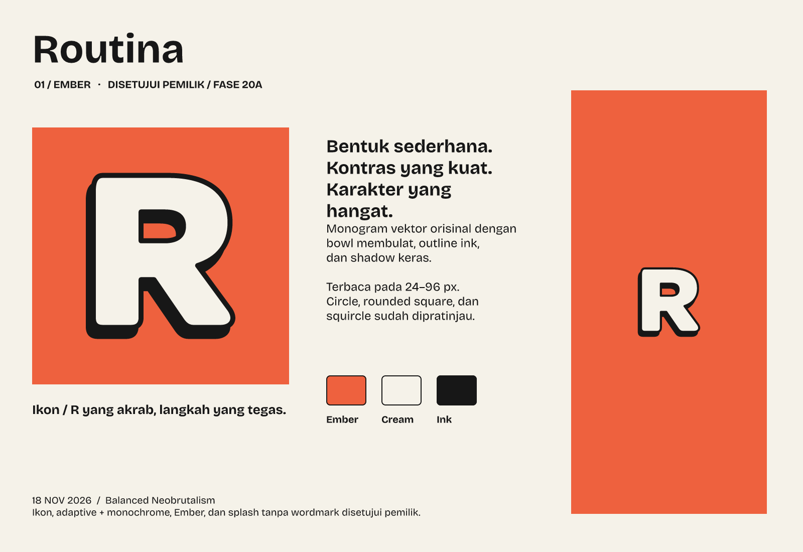

# Branding Routina · ikon dan splash

18 November 2026 · Fase 20A. **Pemilik secara eksplisit menjawab “Setujui seluruh paket branding” setelah review ikon, warna, adaptive mask dan splash ditampilkan.** Paket disetujui mencakup 01 / Ember, adaptive + monochrome, Ember #EE613E, serta splash tanpa wordmark. Integrasi memakai ekspor FigCraft asli; signing produksi, publikasi, dan Fase 20B tidak termasuk.

## Keputusan dan rekomendasi

- **CONFIRMED dari permintaan pemilik:** nama aplikasi `Routina`, final Android applicationId `com.regacode.routina`, distribusi APK langsung dari landing page. ApplicationId, namespace dan package Kotlin kini memakai ID final. iOS tetap memakai identifier sebelumnya sampai ada keputusan terpisah.
- **DISETUJUI pemilik:** ikon **01 / Ember**, disempurnakan dalam `BRAND_Icon_Final`; splash **Ember dengan mark terpusat**, dalam `BRAND_Splash_Final`.
- Monogram R digambar sebagai path vektor orisinal: bowl membulat, counter terbuka, kaki diagonal, outline ink dan shadow keras ke kiri bawah. GIF yang diberikan pemilik dipakai sebagai arah bentuk/warna, tanpa ditempel atau ditrace.
- Warna ekstensi **Ember `#EE613E`** disetujui untuk launcher/splash. Cream `#F5F2E9` dan ink `#171717` memakai token yang tersedia. Palet UI biru/kuning/coral tetap acuan aplikasi. Kontras ink terhadap Ember terhitung **5,48:1**.
- Frame `Final` kini merujuk pilihan yang disetujui. Persetujuan desain tidak menyatakan kesiapan distribusi publik.

## Sumber desain dan inventory frame

[Personal Planner - Flutter UI Design.figcraft](../Personal%20Planner%20-%20Flutter%20UI%20Design.figcraft), halaman baru **12 · Branding & Launch** (14726). Halaman 00–11, seluruh layar dan flow lama dipertahankan. Token existing `Routina / Light` digunakan kembali; ditambah `brand/ember` (VariableID:28). Monogram berupa vektor editable dan tidak bergantung pada font.

| Frame | ID | Ukuran | Kegunaan |
| --- | --- | --- | --- |
| `BRAND_Icon_Exploration_01` | 14730 | 512×512 | Ember: pilihan paling dekat semangat referensi, direkomendasikan. |
| `BRAND_Icon_Exploration_02` | 14735 | 512×512 | Loop: bowl lebih bundar, latar kuning dari palet proyek. |
| `BRAND_Icon_Exploration_03` | 14740 | 512×512 | Forward: R angular ink, shadow krem, latar coral. |
| `BRAND_Splash_Exploration_01` | 14744 | 390×844 | Ember, R dan wordmark. |
| `BRAND_Splash_Exploration_02` | 14748 | 390×844 | Cream, badge Ember dan wordmark. |
| `BRAND_Icon_Final` | 14762 | 1024×1024 | Master ikon square, tanpa mask launcher yang dibakar ke aset. |
| `BRAND_Splash_Final` | 14756 | 390×844 | Pilihan Ember disederhanakan menjadi mark tepat di tengah; tanpa wordmark, tombol, atau loading palsu. |
| `BRAND_AdaptiveIcon_Foreground` | 14771 | 1080×1080 | R cream + ink, latar transparan. |
| `BRAND_AdaptiveIcon_Background` | 14774 | 1080×1080 | Ember opak sampai tepi kanvas. |
| `BRAND_AdaptiveIcon_Composite` | 14775 | 1080×1080 | Foreground + background untuk inspeksi, bukan pengganti layer terpisah. |
| `BRAND_AdaptiveIcon_Preview_Circle` | 14782 | 512×512 | Preview mask lingkaran. |
| `BRAND_AdaptiveIcon_Preview_RoundedSquare` | 14785 | 512×512 | Preview mask sudut membulat. |
| `BRAND_AdaptiveIcon_Preview_Squircle` | 14788 | 512×512 | Preview squircle dengan corner smoothing. |
| `BRAND_AdaptiveIcon_Monochrome` | 14791 | 1080×1080 | Siluet satu warna/alpha untuk konsep themed icon. |
| `BRAND_AdaptiveIcon_SafeZone` | 14795 | 540×540 | Panduan safe zone; tidak disertakan dalam aset foreground. |
| `BRAND_Icon_SmallSizeProof` | 14802 | 1712×260 | Ikon aktual 24/32/48/96 px dengan label terpisah. |
| `BRAND_Splash_Android12_Icon` | 14821 | 288×288 | Mark transparan untuk konsep splash native tanpa icon background. |
| `BRAND_Review_Board` | 14825 | 1600×1100 | Papan review pasangan rekomendasi. |

Eksplorasi wordmark memakai Bricolage Grotesque Bold yang sudah tersedia di proyek; lisensi [SIL OFL](../assets/font/Bricolage_Grotesque/OFL.txt) tetap disertakan. Font tidak diperlukan untuk ekspor monogram ikon/splash native.

## Ekspor dan handoff Android

Seluruh ekspor berasal langsung dari frame FigCraft. [Manifest aset](../design/branding/manifest.json) memuat ID frame, ukuran, dan nama file. File berada di [design/branding/exports](../design/branding/exports/).

| Aset | Format / ukuran | Pemakaian berikutnya |
| --- | --- | --- |
| `routina-icon-ember` | SVG; PNG 1024×1024 (`-1024`) | Master square untuk menurunkan legacy launcher per density. |
| `routina-adaptive-foreground` | SVG; PNG 1080×1080 (`-1080`) dengan alpha | Layer foreground, tidak ditambah inset lagi tanpa mengecek skala. |
| `routina-adaptive-background` | SVG; PNG 1080×1080 (`-1080`) opak | Layer warna Ember terpisah, tanpa radius/mask. |
| `routina-adaptive-monochrome` | SVG 1080×1080 dengan alpha | Kandidat monochrome/themed icon. |
| `routina-splash-icon-android12` | SVG 288×288; PNG 1152×1152 (`-4x`) dengan alpha | Mark native; background layar Ember diatur terpisah pada fase integrasi. |
| `routina-splash-ember-preview` | PNG 780×1688 | Preview komposisi layar; bukan bitmap full-screen native. |
| `routina-brand-review` | PNG 1600×1100 | Review pemilik. |
| `routina-small-size-proof` | PNG 1712×260 | Pemeriksaan ukuran kecil pada skala 100%. |

Adaptive memakai **108×108 dp** per layer, dengan skala desain **10 px/dp**. Artwork penting ditempatkan di lingkaran pusat **diameter 66 dp**. Bounds konservatif foreground termasuk outline dan shadow adalah **424×469,45 px**, terpusat di (540,540); diagonal sekitar 632,58 px, di dalam lingkaran Ø660. Preview tiga mask mensimulasikan crop tengah 72 dp; bentuk mask OEM sebenarnya tetap perlu diuji. [Panduan adaptive Android](https://developer.android.com/develop/ui/compose/system/icon_design_adaptive)

Splash Android 12+ disiapkan untuk mode **tanpa icon background**: kanvas **288×288 dp**, artwork di dalam lingkaran **Ø192 dp**. Bounds konservatif mark termasuk outline dan shadow **124,45×138,34**, diagonal sekitar 186,08, di bawah 192. Mark pada preview 390×844 dan aset native memakai ukuran serta pusat yang konsisten. Latar layar Ember terpisah dari alpha mark. [Panduan splash Android](https://developer.android.com/develop/ui/views/launch/splash-screen)

SVG ikon diekspor dengan stroke menjadi outline dan tanpa font/raster tertanam. SVG tetap sumber desain. [prepare_android_branding.ps1](../tool/prepare_android_branding.ps1) mengonversi path SVG yang sudah di-outline beserta matriks translasi langsung ke VectorDrawable, tanpa menggambar ulang atau menambah dependency. Jalankan script dari root setelah mengekspor SVG FigCraft yang disetujui. Script menolak gambar/teks/stroke atau transform lain yang belum didukung. Legacy PNG diekspor langsung melalui FigCraft pada 48/72/96/144/192 px.

Resource native berada di [android/app/src/main/res](../android/app/src/main/res/): `routina_icon_foreground.xml`, `routina_icon_monochrome.xml`, `routina_splash.xml`, lima density `mipmap`, `mipmap-anydpi-v26` dan `mipmap-anydpi-v33`. Background adaptive memakai `@color/routina_ember`. Splash menggunakan layer-list terpusat pada API 24–30 dan atribut SplashScreen pada `values-v31`/`values-night-v31`. Tema tetap terang saat OS memakai night mode.

Flutter memakai [routina-splash.png](../assets/branding/routina-splash.png), ekspor FigCraft 4× dari viewport 288×288, melalui [RoutinaBrandMark](../lib/presentation/branding/routina_brand.dart). Frame loading layar penuh meneruskan Ember dan pusat mark native, tanpa wordmark, spinner visual atau timer tambahan. Semantik loading tetap tersedia. MainActivity memakai edge-to-edge dan menghapus fade keluar splash sistem untuk menghindari kilatan saat frame identik diteruskan. Entry point mempramuat PNG sebelum first frame dilepas, tanpa timer; instance aplikasi/repository dibuat sekali sebelum builder pramuat. Startup siap instalasi baru tetap menampilkan Mulai/Lanjutkan; error/retry dan state resume tetap tersedia. Logika onboarding serta pemilihan Home bagi profil tersimpan tidak berubah. Metode mengikuti [panduan splash Flutter](https://docs.flutter.dev/platform-integration/android/splash-screen).

## Validasi dan batasnya

- Render FigCraft diperiksa untuk tiga eksplorasi ikon, dua eksplorasi splash, kandidat final, tiga mask, safe zone, papan review, aset native, dan proof 24/32/48/96 px. Counter tetap terbuka pada sampel ukuran kecil; tidak terlihat clipping pada mask yang dibuat.
- Metadata frame, geometri safe zone, viewBox SVG, ukuran PNG dan alpha sudut aset transparan diperiksa. Panduan safe zone tidak ikut di file foreground.
- Keutuhan seluruh node asli halaman 00–11 dibandingkan terhadap `document.json` sebelum penyimpanan. Nilai variabel lama juga dibandingkan; hanya token Ember yang ditambahkan.
- Catatan fase desain awal: runtime Flutter/Android belum diuji pada commit cffc446. Pada Fase 20A format Dart, analyze, 13 tes widget terarah dan seluruh 164 unit/widget test lulus. Build debug, enam skenario integrasi API 36, record notifikasi OS dan [bukti visual aktual](BRANDING_QA.md) juga lulus sesuai cakupan yang dicatat.
- Pemetaan frame, tautan lokal dan `git diff --check` diperiksa. Bukti ini tidak menutup blocker rilis pada [RELEASE_READINESS.md](RELEASE_READINESS.md).

## Pergantian identitas dan data uji

`com.example.routina` dan `com.regacode.routina` adalah dua aplikasi/sandbox Android berbeda. Pemasangan ID baru tidak memindahkan SQLite, profil, izin, alarm, atau antrean notifikasi dari ID lama. Tidak ada migrasi lintas sandbox otomatis atau uninstall yang dilakukan oleh integrasi ini.

1. Pada instalasi uji lama, ekspor backup v1 terenkripsi ke Downloads atau tujuan eksternal yang dipilih pengguna. Simpan password secara terpisah; jangan menghapus aplikasi/data lama.
2. Pasang aplikasi dengan ID baru berdampingan. Jangan menganggap `adb install -r` akan mengubah identitas atau memindahkan data lama.
3. Pada aplikasi baru, pilih file tersebut melalui pemilih dokumen sistem. Tinjau isi dan konflik, lalu setujui Ganti Semua/Gabungkan sesuai kebutuhan instalasi uji.
4. Cocokkan profil/preferensi, kategori, ID/relasi, kegiatan berulang, tugas, rutinitas, histori dan Trash. Timer aktif diekspor sebagai jeda sesuai kontrak backup v1; uji lanjut/hentikan secara terpisah.
5. Izin notifikasi diminta/diberikan pada aplikasi baru, lalu pengingat direkonsiliasi. Hindari dua set pengingat selama pengujian berdampingan dengan mengatur notifikasi pada aplikasi lama; jangan menghapus datanya.

Untuk update publik selanjutnya, applicationId, sertifikat signing yang kompatibel dan versionCode meningkat tetap diwajibkan. Uji backup lintas identitas bukan bukti upgrade in-place signed APK. [Kontrak distribusi dan upgrade](ANDROID_DISTRIBUTION.md#upgrade-manual-dan-integritas-data).

## Status persetujuan

Paket branding ini sudah disetujui pemilik pada Fase 20A. Tidak ada keputusan visual dari paket yang ditawarkan yang masih menunggu persetujuan. Signing, perangkat fisik, iOS, runtime 16 KiB dan blocker distribusi lainnya tetap mengikuti [RELEASE_READINESS.md](RELEASE_READINESS.md).

## Hasil validasi Fase 20A

Fase 20A selesai untuk persetujuan, integrasi identitas/aset dan verifikasi yang diminta. [Laporan QA beserta screenshot dan batas cakupan](BRANDING_QA.md) mencatat 164 unit/widget test, enam skenario native dan pemeriksaan visual aktual. Distribusi publik tetap mengikuti gerbang rilis terpisah.
